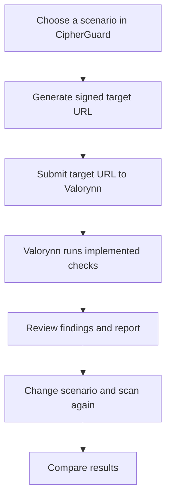

  
  <h1>CIPHERGUARD</h1>
  
<strong>VALORYNN SECURITY TESTING LAB</strong>

  
A controlled demo environment for evaluating the security checks and reporting behavior of <a href="https://github.com/ashfaqhyder/Valorynn"><strong>Valorynn</strong></a>.

  

    
    
    
    
  

  

    <a href="https://github.com/ashfaqhyder/Valorynn">Main project: Valorynn</a> ·
    <a href="https://ashfaqhydercs.vercel.app/">Developer portfolio</a>
  

◈ About CipherGuard
CipherGuard is a companion test application for Valorynn, the main web security assessment project. It provides configurable, controlled HTTP response scenarios so Valorynn can be tested against known security-related signals and its findings can be reviewed.

CipherGuard is not the scanner itself. Valorynn performs the assessment; CipherGuard provides the test target. This separation makes it easier to compare expected configuration with what the scanner actually detects.
[!IMPORTANT]
CipherGuard is an educational and demonstration application. It is not a commercial cybersecurity product, antivirus engine, or guarantee of security. The lab's configured signals are not automatically detected unless Valorynn has corresponding detection rules implemented.

◈ The Valorynn connection

  
  
<strong>MAIN PROJECT · WEB SECURITY ASSESSMENT</strong>

  

Project	Responsibility
Valorynn	Scans supported targets, evaluates implemented checks, and produces findings/reports.
CipherGuard	Serves controlled response configurations to help test scanner behavior and reporting.

Repository: github.com/ashfaqhyder/Valorynn
◈ Features
<table>
  <tr>
    <td width="50%"><strong>01 / Security lab</strong> Configure selected HTTP response signals and compare scenarios.</td>
    <td width="50%"><strong>02 / Scenario presets</strong> Vulnerable baseline, partially repaired, and secure baseline.</td>
  </tr>
  <tr>
    <td><strong>03 / Expected-signal preview</strong> Review which conditions a scenario is intended to expose.</td>
    <td><strong>04 / Signed target URLs</strong> Generate expiring, read-only scenario URLs for repeatable tests.</td>
  </tr>
  <tr>
    <td><strong>05 / Marketplace demo</strong> Product catalogue, product details, pricing, cart, and simulated checkout.</td>
    <td><strong>06 / Interface</strong> Responsive layout with persistent light and dark themes.</td>
  </tr>
</table>

Configurable response signals
- Content Security Policy (CSP)
- X-Content-Type-Options
- Referrer-Policy
- Cross-Origin Resource Sharing (CORS)
- Permissions Policy
- Frame-related protection (X-Frame-Options)
- Demo-cookie security attributes
- Cache-control behavior
- Fictional diagnostic information exposure
- Fictional server-banner disclosure
These controls represent test signals, not a claim that all ten are currently detected by Valorynn. Verify actual scan output and response headers independently.
◈ How the test workflow works

1. Sign in to the CipherGuard admin lab.
2. Select Vulnerable baseline, Partially repaired, or Secure baseline.
3. Generate a target URL for that configuration.
4. Submit the URL to Valorynn using its supported scanning workflow.
5. Review the report and compare the detected findings with the intended scenario.
6. Generate a fresh URL after changing the configuration and repeat the test.
Each URL is signed and expires after 7 days. A configuration change requires a newly generated URL. A finding is only meaningful when validated against the actual response and the scanner's implemented rules.
◈ Technology stack

  
  
  
  
  
  

Technology	Purpose
Next.js + React	Web application and UI
TypeScript	Type-safe application code
Tailwind CSS	Styling and responsive layout
Node.js cryptography	Signing and verifying session/scenario tokens
Vercel	Intended deployment platform

◈ Run locally
Prerequisites
- Node.js 20.9 or later, subject to the installed Next.js version requirements
- npm
- Git
1. Clone the repository
git clone https://github.com/YOUR_USERNAME/cipherguard-marketplace.git
cd cipherguard-marketplace
Replace YOUR_USERNAME with the GitHub account that hosts this repository.
2. Install dependencies
npm install
3. Configure environment variables
On Windows PowerShell:
Copy-Item .env.example .env.local
Generate a strong random value with Node.js. Run the command separately for each secret so they are different:
node -e "console.log(require('crypto').randomBytes(32).toString('base64url'))"
Update .env.local with your own values:
DEMO_ADMIN_PASSWORD=replace-with-a-strong-local-password
DEMO_SESSION_SECRET=replace-with-a-random-secret
DEMO_SCENARIO_SECRET=replace-with-a-different-random-secret
NEXT_PUBLIC_SITE_URL=http://localhost:3000
Never commit .env.local or publish real secrets.
4. Start the development server
npm run dev
Open http://localhost:3000.
5. Verify a production build
npm run build
Resolve build errors and review dependency security advisories before deployment.
◈ Deploy to Vercel
1. Push this project to its own GitHub repository. Keep it separate from the Valorynn repository unless you intentionally want a monorepo.
2. Import the repository into Vercel.
3. Add these environment variables in Vercel project settings for Production and any Preview environments you intend to test:
   - DEMO_ADMIN_PASSWORD — strong, unique admin password.
   - DEMO_SESSION_SECRET — cryptographically random secret, at least 32 characters.
   - DEMO_SCENARIO_SECRET — a different cryptographically random secret, at least 32 characters.
   - NEXT_PUBLIC_SITE_URL — exact deployed HTTPS origin, with no trailing slash.
4. Deploy and open /admin/login.
5. Sign in, choose a scenario, and generate a target URL.
6. Scan the URL with Valorynn and compare the results against another scenario.
Use fresh production secrets. Do not use a development fallback password or commit secrets to the repository.
◈ Routes
Route	Purpose
/	Home page
/products	Product catalogue
/products/[slug]	Product detail
/pricing	Plan comparison
/cart	Browser-local cart
/checkout	Simulated checkout
/about	Demo scope and principles
/admin/login	Admin sign-in
/admin	Security testing lab
/api/target?scenario=<signed-token>	Controlled scan target

◈ Deployment and security notes
- The marketplace is fictional. Checkout does not process payments, issue licences, or save real customer orders.
- Vercel Functions are stateless. The scenario configuration is carried in a signed, expiring token rather than shared in-memory state.
- The target endpoint is public to anyone who has a valid signed URL. Treat that URL as a short-lived demo token and avoid sharing it publicly.
- The scenario token selects predefined behavior. It does not provide a shell, arbitrary code execution, secret access, or arbitrary header injection.
- Some headers, including HSTS, may be controlled by the hosting platform. Inspect the deployed HTTP response rather than assuming the lab controls every header.
- The CSP toggle affects the target endpoint response. Because the endpoint returns JSON rather than an HTML document, some browser-focused CSP checks may not flag it.
- The admin login uses a shared demo password, not a full identity-management system. Before any public commercial use, add a proper identity provider, rate limiting, audit logging, and role-based access control.
- Only scan systems you own or have explicit permission to assess.
◈ Roadmap
- [ ] Expand scenario coverage for additional supported vulnerability categories
- [ ] Automate comparison of expected signals and Valorynn findings
- [ ] Track false positives and false negatives
- [ ] Add repeatable scanner regression tests
- [ ] Add exportable test reports
- [ ] Improve scenario documentation

◈ Test Application for:

       
  
◈ Developer

  
  
<strong>Ashfaq Hyder C S</strong>

  

    <a href="https://github.com/ashfaqhyder">GitHub</a> ·
    <a href="https://www.linkedin.com/in/ashfaq-hyder-c-s/">LinkedIn</a> .
  

  BUILT AS A TEST ENVIRONMENT FOR VALORYNN · FOR AUTHORIZED SECURITY TESTING AND EDUCATIONAL DEMONSTRATIONS

